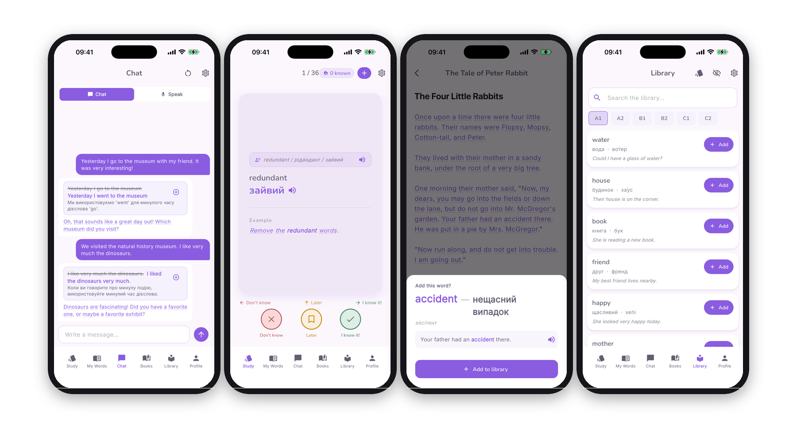
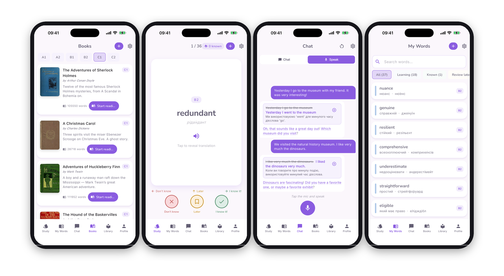
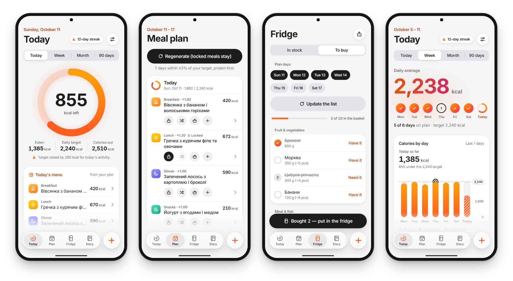
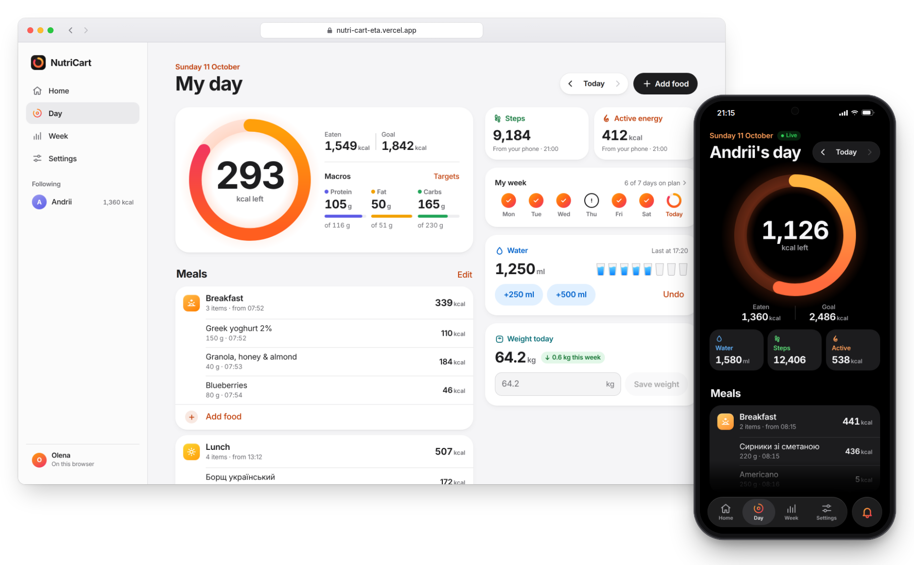
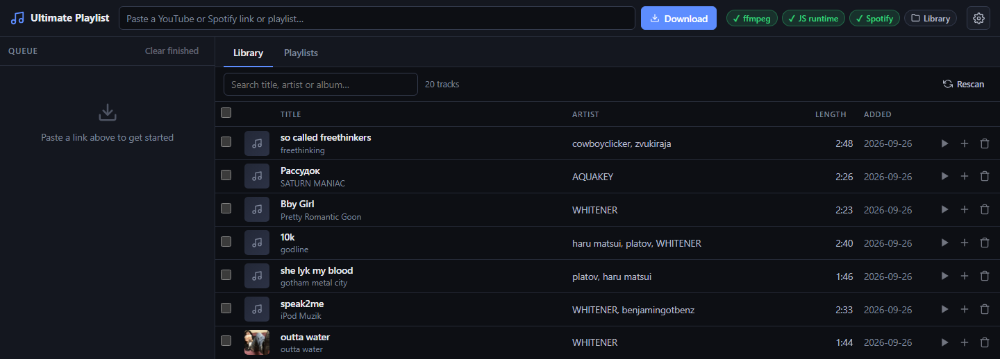

# Hi, I'm Serhii

Mobile and web developer in Bath, UK. I build apps for iPhone, Android and the web, and the backend behind them, from the first screen to the store release. My language app, Slovira, is live on the App Store, Google Play and the Microsoft Store.

I'm also a Cyber Security student at Bath Spa University, so security is part of how I build.

## What I build

- Mobile apps for iPhone and Android from one codebase (Flutter), or native Android apps (Kotlin, Jetpack Compose)
- Websites and web apps in React and TypeScript, installable on a phone like an app
- The backend: sign-in, databases, cloud sync and notifications, on Firebase or Supabase (Postgres)
- Apps that keep working offline and sync when the connection is back
- Store releases and updates, from review to staged rollout
- Security: rules for who can see and change each piece of data, secure sign-in, security headers, account deletion, and tests that check them

## Slovira

A language-learning app for 33 languages. I built it in about four months and released it on four stores from one Flutter codebase. The source is private because the app is commercial.

[App Store](https://apps.apple.com/app/id6779954616) · [Google Play](https://play.google.com/store/apps/details?id=com.slovira.app) · [Microsoft Store](https://apps.microsoft.com/detail/9P23HG4KC5BT) · [slovira.app](https://slovira.app)

App Store screenshots. Translations are in Ukrainian, the language pair of the account used for the captures.

- Stack: Flutter/Dart, Firebase (Auth, Firestore, Cloud Functions, FCM), offline-first with Hive and cloud sync
- Platforms: iOS, Android, Windows, Chrome and Firefox extensions, all on one Firestore backend
- Features: spaced-repetition reviews (SM-2), an AI chat tutor (Cloud Functions with per-user quotas), a reader with 140+ graded books in 17 languages, XP and leaderboards, text-to-speech
- Releases: store reviews, staged rollouts, data migrations, 30 app languages, in-app account deletion

## NutriCart

A nutrition tracker in three parts: an Android app, a website and the cloud backend that connects them. The weekly meal plan turns into a grocery list, and a partner can follow your day from the website. The source is private, but you can try both: the [website](https://nutri-cart-eta.vercel.app) opens without signing up, and the [Android app](https://github.com/Serhikko/Serhikko/releases/latest) installs from its release page (Android 9 or newer).

Demo data. Dish names are in Ukrainian, as in the app's built-in recipes.

- Phone app: Kotlin, Jetpack Compose, Room, Hilt, WorkManager, Health Connect, a home-screen widget and its own design system. It works fully offline. With cloud sync on, changes go both ways once the phone is online.
- Website: React 19, TypeScript, Vite, TanStack Query, installable as a PWA. Use it as your own tracker, or follow someone's day with a 6-character pairing code and send nudges that arrive on their phone as notifications.
- Backend: Supabase (Postgres with row-level security, Realtime). Database changes are rehearsed on a throwaway database, then applied by GitHub Actions.
- Food: barcode scanning, with product data from Open Food Facts and Ukrainian shop catalogues.
- Languages: English and Ukrainian; the website also Belarusian and Russian.
- Security: two attacker-style reviews of the website and database, then the fixes. Sign-in links work only in the browser that asked for them, security headers block injected scripts, each account has limits, and the data-access rules are tested as owner, partner and stranger.

Demo data. The people are invented.

## Ultimate Playlist

A desktop tool that turns YouTube and Spotify links into tagged MP3s with cover art in one folder, with playlists you can export for a car USB stick, a phone or VLC. [Serhikko/ultimate-playlist](https://github.com/Serhikko/ultimate-playlist)

The local web UI, running on this PC.

- Stack: Python, FastAPI, yt-dlp, mutagen, a plain HTML/JS web UI
- Spotify links: track lists come from Spotify and the audio is matched on YouTube Music; optional Spotify sign-in (OAuth with PKCE) for your own playlists
- Windows download that needs nothing installed (PyInstaller, bundled ffmpeg), offline test suite and CI on Windows and Ubuntu

## Currently

- BSc (Hons) Cyber Security at Bath Spa University, year 2. A grades in CodeLab, Web Dev I and Digital Forensics.
- Open to freelance work on mobile apps, websites and backends, and to part-time and placement roles: s.prynkevych@gmail.com
